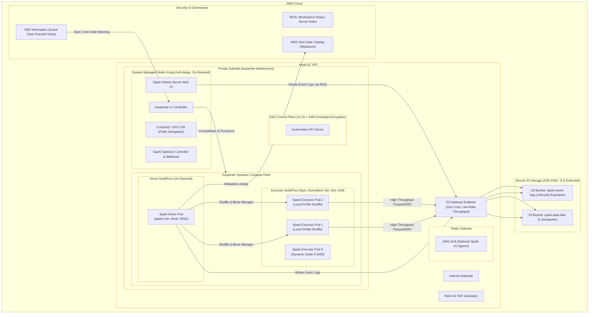

# Production-Grade Apache Spark on Amazon EKS (Kubernetes) with Reusable Terraform Modules

[](https://www.terraform.io/)
[](https://kubernetes.io/)
[](https://spark.apache.org/)
[](https://karpenter.sh/)
[](https://aws.amazon.com/eks/)

This repository provides a modular, secure, and production-ready Infrastructure as Code (IaC) implementation to run **Apache Spark on Amazon Elastic Kubernetes Service (EKS)** at scale.

Designed according to AWS Well-Architected and Kubernetes big data best practices, it couples **Kubeflow Spark Operator**, **Karpenter v1 Autoscaling**, **Prefix Delegation**, **IAM Roles for Service Accounts (IRSA)**, **S3 Gateway Endpoints**, and **Spark History Server** for high performance, security, and up to 70% cost savings over traditional clusters.

---

## 🏛️ Architecture Overview



---

## 📦 Key Highlights & Production Features

| Feature | Production Implementation |
|---|---|
| **EKS Architecture** | Kubernetes v1.31, Customer Managed KMS Key secret envelope encryption, multi-AZ control plane logging to CloudWatch. |
| **Compute Autoscaling** | **Karpenter v1** replaces legacy Cluster Autoscaler: provisions nodes in < 45s, isolates Drivers (On-Demand) from Executors (Spot), handles Spot terminations gracefully via SQS + EventBridge. |
| **Networking & Pod Density** | AWS VPC CNI with **Prefix Delegation** (`ENABLE_PREFIX_DELEGATION=true`) enabled, eliminating EC2 ENI limits so high-density Spark executor instances can host up to 110 pods without IP exhaustion. |
| **Zero-Cost S3 Data Path** | **VPC S3 Gateway Endpoint** configured across all route tables. Multi-terabyte Spark reads/writes bypass NAT Gateways, eliminating \$0.045/GB data transfer charges and NAT bandwidth bottlenecks. |
| **IAM Security (IRSA)** | Strict least-privilege IAM Roles for Service Accounts. Spark pods never use EC2 instance profiles; separate IRSA roles for Spark Applications and Spark History Server with S3 KMS and AWS Glue Catalog access. |
| **Storage & Shuffle I/O** | Support for local NVMe SSD instance storage (`r5d`, `r6id`, `m5d`, `c5d`) mapped to `spark.local.dir` for high-throughput shuffle and spill performance. |
| **Spark Operator & CRDs** | Deploys official `spark-operator` Helm chart with mutating admission webhooks, Prometheus metrics export, and namespace-scoped RBAC. |
| **Spark History Server** | Persistent History Server deployment configured with S3A filesystem connector and IRSA, reading event logs from S3 with automated lifecycle cleanup. |

---

## 🗂️ Repository Directory Structure

```text
aws-spark-on-k8s/
├── modules/
│   ├── vpc/                     # Multi-AZ VPC, NAT Gateways, S3 & Interface Endpoints, Flow Logs
│   ├── eks/                     # EKS v1.31, KMS Key, Addons (VPC-CNI prefix delegation), System Node Group
│   ├── s3_spark/                # S3 Buckets for event logs & data lake, KMS Key, TLS enforcement
│   ├── iam_spark_irsa/          # IRSA policies & roles for Spark workloads & History Server
│   ├── karpenter/               # Karpenter v1 controller, interruption SQS, Driver & Executor NodePools
│   │   └── charts/              # Local Helm chart for Karpenter NodePools & EC2NodeClass
│   ├── spark_operator/          # Spark Operator Helm chart, RBAC, ServiceAccount with IRSA
│   └── spark_history_server/    # Spark History Server deployment, S3A configuration, Service
├── environments/
│   ├── dev/                     # Cost-optimized dev setup (single NAT, small nodes, quick expiration)
│   └── prod/                    # High-availability production setup (multi-AZ NAT, spot diversification)
├── examples/
│   └── spark-applications/
│       ├── pyspark-pi.yaml               # Basic smoke test SparkApplication
│       ├── s3-data-processing.yaml       # Dynamic allocation + S3A committer ETL job
│       └── dynamic-allocation-nvme.yaml  # Local NVMe scratch volume shuffle job
├── scripts/
│   ├── validate-prerequisites.sh         # CLI tool and AWS credential validator
│   └── submit-spark-job.sh               # Job submission script injecting S3 outputs
├── Makefile                              # Make targets for linting, planning, applying, and testing
├── terraform.tfvars.example              # Sample variable definitions
├── main.tf                               # Root composition module
├── variables.tf                          # Root variable definitions
├── outputs.tf                            # Root outputs (cluster info, S3 buckets, IRSA ARNs)
├── versions.tf                           # Required providers and Terraform versions
└── README.md
```

---

## 🚀 Quick Start & Deployment Guide

### Step 1: Verify Prerequisites

Ensure you have the following installed locally:
- [Terraform](https://learn.hashicorp.com/tutorials/terraform/install-cli) (>= 1.5.0)
- [AWS CLI](https://docs.aws.amazon.com/cli/latest/userguide/install-cliv2.html) (>= 2.x) configured with administrative credentials
- [kubectl](https://kubernetes.io/docs/tasks/tools/) (>= 1.28)
- [Helm](https://helm.sh/docs/intro/install/) (>= 3.x)

Run the automated prerequisite checker:
```bash
make check
```

### Step 2: Initialize & Apply Terraform

You can deploy directly using the root configuration or via `environments/prod/`:

#### Option A: Root Deployment
```bash
cp terraform.tfvars.example terraform.tfvars
# Adjust variables (e.g. aws_region, cluster_name) as needed

terraform init
terraform plan -out=tfplan
terraform apply tfplan
```

#### Option B: Dedicated Production Environment
```bash
cd environments/prod
cp terraform.tfvars.example terraform.tfvars

terraform init
terraform plan -out=tfplan
terraform apply tfplan
```

### Step 3: Configure `kubectl`

Update your local Kubernetes configuration context:
```bash
make kubeconfig
# or run the command emitted in Terraform outputs:
aws eks --region us-west-2 update-kubeconfig --name spark-on-eks
```

Verify cluster nodes and Spark operator:
```bash
kubectl get nodes -L role,workload
kubectl get pods -n spark-operator
kubectl get pods -n spark-history
```

---

## ⚡ Running Spark Jobs

### 1. Smoke Test (PySpark Pi)
Submit a simple job to verify the operator, IRSA, and driver/executor scheduling:
```bash
make job-pi
# Or manually:
./scripts/submit-spark-job.sh examples/spark-applications/pyspark-pi.yaml spark-apps
```

### 2. Production ETL with Dynamic Allocation & S3A Committer
Run a heavy ETL pipeline using Spark Dynamic Allocation (without external shuffle service) and S3A directory committer:
```bash
make job-s3
# Or manually:
./scripts/submit-spark-job.sh examples/spark-applications/s3-data-processing.yaml spark-apps
```

### 3. Monitoring Application Execution
```bash
# Watch SparkApplication status
kubectl get sparkapplications -n spark-apps -w

# Inspect driver logs
kubectl logs -f pyspark-pi-driver -n spark-apps

# View Karpenter autoscaling executor nodes in real-time
kubectl get nodes -l spark-role=executor -w
```

---

## 🖥️ Accessing Spark History Server

The Spark History Server UI provides visual execution DAGs, task skew details, executor allocation metrics, and event log inspection for all completed and active jobs.

Forward the UI port to your local machine:
```bash
make port-forward-history
```
Then open your browser at **[http://localhost:18080](http://localhost:18080)**.

---

## ⚙️ Spark on EKS Tuning & Production Best Practices

### 1. Dynamic Allocation with Shuffle Tracking
Traditional Spark on YARN requires an External Shuffle Service daemon. On Kubernetes, Spark 3.x provides **Shuffle Tracking**:
```yaml
sparkConf:
  "spark.dynamicAllocation.enabled": "true"
  "spark.dynamicAllocation.shuffleTracking.enabled": "true"
  "spark.dynamicAllocation.shuffleTracking.timeout": "300s"
  "spark.dynamicAllocation.minExecutors": "2"
  "spark.dynamicAllocation.maxExecutors": "50"
  "spark.dynamicAllocation.executorIdleTimeout": "60s"
```
Executors holding shuffle files will be retained until the timeout expires, while idle executors with no shuffle dependencies scale down immediately.

### 2. Cost Optimization: Drivers on On-Demand, Executors on Spot
- **Driver Pod**: If a driver pod dies due to Spot preemption, the entire Spark job fails and must be restarted. Our driver NodePool strictly uses `on-demand` instances.
- **Executor Pods**: If an executor pod is preempted, Spark simply retries the missing tasks on surviving or newly scheduled executors. Karpenter provisions Spot instances across diversified families (`r5d`, `r6id`, `m5d`, `c5d`, `r5`, `r6i`), saving up to 70% in compute costs.

### 3. High-Speed Shuffle Storage via Local NVMe SSDs
For shuffle-heavy jobs, EBS volume throughput can become a bottleneck. Using instance types with local NVMe disks (the `d` family like `r5d.2xlarge`) provides millions of IOPS:
```yaml
volumes:
  - name: spark-local-dir-nvme
    emptyDir: {}

sparkConf:
  "spark.local.dir": "/tmp/spark-local-dir"

executor:
  volumeMounts:
    - name: spark-local-dir-nvme
      mountPath: /tmp/spark-local-dir
```

### 4. S3A Committer Optimization
Never use standard `FileOutputCommitter` with S3: Amazon S3 does not have atomic file rename operations, causing multi-hour job delays when committing thousands of partitions. Instead, use the **S3A Directory Committer**:
```yaml
sparkConf:
  "spark.hadoop.fs.s3a.fast.upload": "true"
  "spark.hadoop.fs.s3a.fast.upload.buffer": "bytebuffer"
  "spark.hadoop.fs.s3a.committer.name": "directory"
  "spark.hadoop.fs.s3a.committer.staging.conflict-mode": "replace"
  "spark.sql.sources.commitProtocolClass": "org.apache.spark.internal.io.cloud.PathOutputCommitProtocol"
  "spark.sql.parquet.output.committer.class": "org.apache.spark.internal.io.cloud.BindingParquetOutputCommitter"
```

---

## 🧹 Teardown & Cleanup

To destroy all provisioned AWS and Kubernetes resources safely:
```bash
# 1. Terminate any running Spark jobs
kubectl delete sparkapplications --all -n spark-apps

# 2. Destroy infrastructure via Terraform
make destroy
# or: terraform destroy
```

---

## 📄 License

This repository is licensed under the Apache 2.0 License.
